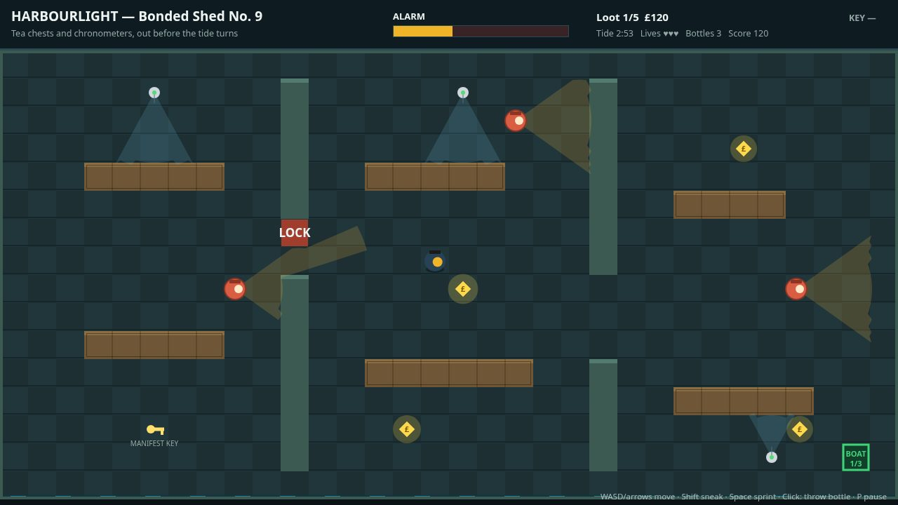

# Harbourlight: The Low-Tide Job

[](https://make.fun/bounty/best-heist-game-20261122-0559?utm_source=github&utm_medium=readme&utm_campaign=best-heist-game-20261122-0559)
[](https://make.fun/bounty/best-heist-game-20261122-0559/leaderboard?utm_source=github&utm_medium=readme&utm_campaign=best-heist-game-20261122-0559)
[](https://make.fun/bounty/best-heist-game-20261122-0559?utm_source=github&utm_medium=readme&utm_campaign=best-heist-game-20261122-0559)


An original top-down harbour heist for the desktop browser. One night, one
tide: **Wren the dock-thief** slips into the customs warehouses of a sleeping
port and empties three of them before the water turns — **Bonded Shed No. 9**,
**The Coldstore Annex**, and **The Tide Vault** itself.



## The job

- Lift **at least 3 of the 5 treasures** in each shed — tea chests,
  chronometers, the Meridian Astrolabe — each labelled and priced in the HUD.
- Take the **brass manifest key** and open the red **customs door**.
- Reach the getaway **BOAT** at the dock gate before the 4-minute tide timer
  runs out, over 3 lives.

## Staying unseen

- **Wardens** patrol loops with vision cones **cut ray-by-ray by the crate
  stacks and walls** — step behind a stack and the cone stops at it. Spotted
  wardens give chase; a hand on your collar while the alarm runs hot ends
  the attempt.
- **Harbour cameras** sweep their own blue cones across the sheds.
- Both feed one **ALARM meter**, always on screen in the harbour-office HUD:
  it climbs while you are seen, cools while you are hidden, and a full meter
  blows the job.
- **Sneak** (Shift) to move quietly, **sprint** (Space) at the price of
  noise that pulls wardens off their loops, and **click** to throw one of
  your 3 bottles — the clink draws wardens to investigate the landing spot.
- A quiet, fast getaway pays a ghost bonus on top of the loot.

## Controls

| Input | Action |
| --- | --- |
| WASD / arrow keys | Move |
| Shift | Sneak (slow, near-silent) |
| Space | Sprint (fast, noisy) |
| Mouse click | Throw a bottle distraction |
| P | Pause |
| Enter | Start / restart |

## Play it

No build step and no network: serve the static files and open the page.

```sh
node serve.ts            # then open http://localhost:8080
```

`main.ts` (Node 22, standard library only) is the hand-in program: it copies
`game/` and `screenshots/` to the output directory and writes the dossier.
The game code lives in `game/src/` — `levels.js` (the three sheds as tile
data), `world.js` (the simulation: movement, patrols, cone detection cut by
walls, the alarm), `render.js` (canvas painting and the HUD), `input.js`,
`audio.js` (oscillator harbour sounds) and `shots.js` (the staged screenshot
scenes behind `?shot=`).

## Licence

MIT — see [LICENSE](LICENSE).
